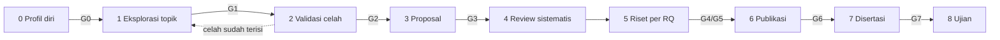

# PhD-Workbench

**Meja kerja studi doktoral berbasis AI-agent**, berupa *template repository* Markdown + Git untuk
mahasiswa S3 (terutama ilmu komputer). Workbench ini menemani dari **sebelum punya topik** sampai
**disertasi selesai**.

Workbench ini tidak menulis disertasi untuk Anda. Ia menyediakan struktur, aturan, dan prosedur
percakapan agar asisten AI (Claude Code, Codex, Gemini CLI, dll.) membantu Anda **berpikir, mencari,
merapikan, dan mengkritik** secara disiplin, tanpa mengarang referensi.

> Status: **v0.2 (awal)**. Rancangan lengkapnya ada di [`docs/spesifikasi.md`](docs/spesifikasi.md).

---

## Apa isinya?

- **Struktur folder mengikuti siklus hidup S3**: profil diri → eksplorasi topik → validasi celah →
  proposal → riset per RQ → publikasi → disertasi → ujian.
- **Gate keputusan (G0–G7)**: checklist syarat sebelum masuk ke tahap berikutnya, di `_gate/`.
- **Template dokumen**: profil diri, kartu ide, matriks skor, uji tekan, *Topic Decision Record*,
  scoping review, resume paper, protokol studi, log harian, catatan bimbingan, dll., di `_templates/`.
- **Skill percakapan AI** di `.claude/skills/`: prosedur wawancara dan kerja yang dijalankan agen.
- **Aturan kerja** ([`ATURAN.md`](ATURAN.md)): gate sitasi tiga langkah, batas data sensitif,
  protokol sebelum data, dan etika.
- **Skrip ringan** `scripts/wb.py` (Python stdlib): status proyek, cek gate, dan cek sitasi.



---

## Mulai cepat

### 1. Prasyarat
- [Git](https://git-scm.com/) dan akun GitHub/GitLab (opsional, tetapi sangat disarankan untuk riwayat dan backup)
- Editor: [VS Code](https://code.visualstudio.com/) (disarankan), Obsidian, atau editor Markdown lain
- AI agent: [Claude Code](https://docs.claude.com/en/docs/claude-code) (utama). Codex CLI, Gemini CLI, dan
  sejenisnya juga bisa dipakai lewat `AGENTS.md`
- Python 3.10+ (untuk `scripts/wb.py`; opsional)

### 2. Buat repo Anda sendiri
Pilih salah satu:

- **GitHub:** klik **Use this template** → *Create a new repository* → pilih **Private**.
- **Manual:**
  ```bash
  git clone https://github.com/kaqfa/phd-workbench.git disertasi-saya
  cd disertasi-saya
  git remote remove origin   # lalu tambahkan remote repo privat Anda sendiri
  ```

> ⚠️ **Jadikan repo Anda PRIVAT.** Repo ini nantinya berisi profil pribadi, ide riset yang belum
> terbit, catatan bimbingan, dan mungkin data penelitian.

### 3. Buka di editor dan jalankan agen
```bash
code .        # buka di VS Code
claude        # jalankan Claude Code di terminal (atau lewat ekstensi VS Code)
```

### 4. Mulai mengobrol
Mahasiswa yang **belum punya topik** cukup mengetik:

> tolong bantu aku mencari topik untuk S3

Agen akan:
1. **Memprofil Anda** (latar, keahlian, minat, aset riset, batasan, target karier), satu tema per
   giliran, dan mencatatnya di `01-profil-diri/`.
2. **Menggali ide** dari empat sumber dan menulis 10–20 **kartu ide** di `02-eksplorasi-topik/kartu-ide/`.
3. **Menskor** ide bersama Anda, lalu **menguji tekan** ide-ide teratas sebagai penguji skeptis.
4. Membantu menulis **Topic Decision Record (TDR)**, lalu **scoping review** untuk memastikan
   celahnya memang ada.

Setiap kali kembali bekerja, ketik saja:

> kita lanjutkan pekerjaan, apa lagi yang perlu kita lakukan

Agen akan membaca `workbench.yaml`, `STATUS.md`, log terakhir, dan catatan bimbingan, lalu
mengusulkan 1–3 langkah berikutnya.

### Contoh perintah lain

| Anda bilang… | Yang terjadi (skill) |
|---|---|
| "aku sudah punya 3 ide, tolong nilai" | Ide dimasukkan sebagai kartu → `skor-ide` |
| "kritik topikku seperti penguji" | `uji-tekan` |
| "cek apakah celah riset ini sudah diisi orang" | `scoping` |
| "buat resume paper ini" (dengan PDF di `04-literatur/pdf/`) | `resume` dengan kutipan verbatim + halaman |
| "cek konsistensi RQ dan rencana paperku" | `rantai` |
| "review draf proposalku" | `kritik-naskah` |
| "besok aku bimbingan, siapkan agendanya" | `bimbingan` |
| "evaluasi kuartal ini" | `retro` |

Di Claude Code, skill juga bisa dipanggil langsung, misalnya `/profil` atau `/lanjut`.

### Tanpa AI agent?
Workbench ini tetap bisa dipakai secara manual. Salin template dari `_templates/`, ikuti checklist
di `_gate/`, dan baca prosedur di `.claude/skills/*/SKILL.md` sebagai panduan kerja.

---

## Peta folder

| Folder | Isi | Fase |
|---|---|---|
| `00-admin/` | Regulasi kampus, beasiswa, promotor, izin etik, seminar | semua |
| `01-profil-diri/` | Profil, aset riset, refleksi | 0 |
| `02-eksplorasi-topik/` | Kartu ide, matriks skor, uji tekan, TDR | 1 |
| `03-proposal/` | Draf, naskah resmi, arsip versi, seminar | 3 |
| `04-literatur/` | PDF, resume, `references.bib`, scoping, review sistematis | 1–7 |
| `05-riset/` | Satu folder per RQ (salin dari `_rq-template/`) | 5 |
| `06-subjek-data/` | Modul data sensitif / sintetis | 5 |
| `07-artefak/` | Modul prototype, prompt, konfigurasi model | 5 |
| `08-publikasi/` | Peta venue, strategi, folder per paper | 4–6 |
| `09-disertasi/` | Pemetaan RQ → paper → bab, naskah | 3, 7 |
| `10-presentasi/` | Slide, persiapan ujian | semua |
| `11-jurnal-riset/` | Log harian, bimbingan, keputusan (ADR), retrospeksi | semua |
| `12-kuliah/` | Tugas kuliah yang ditautkan ke disertasi | awal |
| `99-arsip/` | Materi usang yang masih dirujuk | — |

Berkas di akar:

| Berkas | Fungsi |
|---|---|
| `ATURAN.md` | Satu sumber aturan untuk manusia & agen |
| `CLAUDE.md` / `AGENTS.md` | Instruksi untuk agen AI |
| `workbench.yaml` | Konfigurasi proyek (diisi agen saat profiling) |
| `STATUS.md` | Status proyek, **dibangkitkan skrip**, jangan diedit tangan |

Setiap folder memiliki `README.md` singkat yang menjelaskan **apa isinya** dan **kapan dipakai**.
Folder untuk fase yang belum aktif boleh diabaikan dulu.

---

## Skrip `wb`

```bash
python3 scripts/wb.py status              # bangkitkan STATUS.md
python3 scripts/wb.py cek gate G1         # butir gate yang belum terpenuhi
python3 scripts/wb.py cek sitasi          # cek sitasi di folder naskah standar
python3 scripts/wb.py cek sitasi 03-proposal/draf/proposal.md
```

`cek sitasi` mengenali `\cite{...}` (LaTeX) dan `[@key]` (Pandoc/Markdown). Untuk setiap kunci, skrip
memeriksa apakah kunci ada di `references.bib`, apakah `note` berstatus `VERIFIED`, dan apakah ada
resumenya. Skrip juga menandai penanda `[CARI:`, `DRAF-AGEN`, dan `[TODO` yang masih tersisa.

---

## Ritme kerja yang disarankan

| Irama | Aktivitas |
|---|---|
| Setiap sesi | Mulai dengan "kita lanjutkan"; agen menutup sesi dengan log + status |
| Mingguan | Satu sesi resume literatur; rapikan board `.agents/kanban/` |
| Sebelum/sesudah bimbingan | "siapkan bimbingan" / "rapikan catatan bimbingan" |
| Bulanan | `wb status`; periksa `git status` dan data sensitif; commit + push |
| Per kuartal | "retrospeksi kuartal ini"; tinjau ulang TDR |
| Sebelum submit/seminar | `wb cek sitasi`, `kritik-naskah`, `uji-tekan` |

## Sudah punya topik atau sedang di tengah studi?
Katakan kondisi Anda ke agen, misalnya *"aku sudah semester 4, topikku X, file-ku berantakan"*.
Agen akan mengatur `fase_aktif` di `workbench.yaml` dan membantu memindahkan berkas lama.
Prioritas migrasinya adalah: `references.bib` beserta status verifikasi, protokol RQ yang aktif, lalu
rekonstruksi keputusan penting sebagai ADR.

---

## Limitasi

- **Bukan pengganti promotor.** Workbench menyiapkan bahan diskusi dan mencatat keputusan, tetapi
  keputusan riset tetap di tangan Anda dan promotor.
- **Agen AI bisa salah dan bisa berhalusinasi**, termasuk mengarang paper, kutipan, angka, atau
  aturan kampus yang terdengar meyakinkan. Gate sitasi dan penanda `[CARI: ...]` mengurangi risiko
  ini, tetapi **tidak menghilangkannya**. Periksa sendiri setiap sumber.
- **`wb cek sitasi` hanya memeriksa keberadaan dan status**, bukan kebenaran isi klaim. Kebenaran
  isi hanya bisa dipastikan dengan membaca sumbernya.
- **Pengetahuan agen punya batas waktu.** Tanpa akses web, agen tidak tahu paper terbaru. Kebaruan
  topik harus divalidasi lewat scoping review dengan pencarian sungguhan.
- **Syarat formal kampus tidak dibawa.** Profil Udinus di `_templates/profil-kampus/udinus/` masih
  berupa kerangka bertanda `BELUM DICEK`. Isi dari pedoman resmi kampus Anda.
- **Angka di template (bobot skor, durasi, jumlah ide) adalah usulan desain**, belum hasil validasi
  empiris. Silakan sesuaikan dan catat alasannya.
- **Bias disiplin.** Rancangan ini diturunkan dari riset software engineering. Modul kualitatif dan
  survei tersedia, tetapi belum diuji di disiplin lain.
- **Butuh kenyamanan dasar** dengan Markdown, terminal, dan (idealnya) Git.

## ⚠️ Peringatan etika & integritas akademik

1. **Anda adalah penulis disertasi Anda.** Agen boleh membuat draf dan mengkritik, tetapi setiap
   teks yang Anda serahkan harus Anda pahami, sunting, dan pertanggungjawabkan. Draf dari agen
   ditandai `<!-- DRAF-AGEN -->` sampai Anda menyuntingnya.
2. **Workbench ini bukan alat joki.** Menyerahkan karya yang dihasilkan AI sebagai karya sendiri
   tanpa pengungkapan dapat dianggap pelanggaran integritas akademik, dan sanksinya bisa sampai
   pencabutan gelar.
3. **Jangan pernah mengarang referensi, data, atau hasil.** Gunakan placeholder yang jelas
   (`[CARI: ...]`, `[TODO: butuh data dari RQ-2]`).
4. **Patuhi kebijakan AI kampus dan venue publikasi.** Banyak jurnal dan konferensi mewajibkan
   pernyataan penggunaan AI, dan sebagian melarang AI untuk bagian tertentu.
5. **Lindungi data penelitian.** Data pribadi, data institusi, atau data partisipan **tidak boleh**
   dikirim ke layanan AI pihak ketiga tanpa izin pemilik data dan persetujuan etik. Simpan data
   seperti itu di `06-subjek-data/sensitif/` (di-ignore Git), lalu atur
   `data.boleh_ke_model_tertutup`.
6. **Perhatikan privasi Anda sendiri.** Percakapan dengan agen AI dikirim ke penyedia model.
   Pertimbangkan apa yang Anda bagikan dan baca kebijakan privasi penyedianya.
7. **Hak cipta.** PDF paper tidak di-commit secara default. Jangan menyebarkan repo yang berisi PDF
   berhak cipta.

Aturan lengkapnya ada di [`ATURAN.md`](ATURAN.md) §5.

---

## Lisensi

[MIT](LICENSE). Silakan pakai, modifikasi, dan sebarkan. Masukan dan kontribusi (terutama dari
disiplin non-SE dan profil kampus lain) sangat diharapkan lewat *issue* atau *pull request*.
