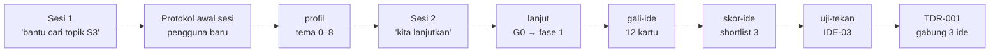

# Dry-run 01 — Alur P1 dari Profiling sampai TDR

> **Tanggal:** 2026-10-10 · **Versi template:** v0.2
> **Sifat:** simulasi. Agen dan mahasiswa **dimainkan oleh AI yang sama**, mengikuti `CLAUDE.md` dan
> `SKILL.md` langkah demi langkah di salinan repo yang terpisah. Semua nama, data, dan paper dalam dokumen ini
> **FIKTIF**.

## Keterbatasan dry-run

Dry-run ini memeriksa **alur, berkas, dan skrip**: apakah langkah-langkahnya jelas, apakah berkas yang
dirujuk memang ada, dan apakah `wb.py` membaca hasil kerja dengan benar. Dry-run ini **tidak** menguji
pengalaman pengguna sungguhan. Karena pemeran mahasiswa juga AI, jawabannya cenderung kooperatif dan
terstruktur, sehingga tingkat keberhasilan alur ini kemungkinan terlalu optimistis. Uji dengan mahasiswa
sungguhan tetap diperlukan (spesifikasi §13, v1.0).

## Persona

**Rina (FIKTIF)**, P1 (belum bertopik).

- Dosen Informatika di PTS selama 8 tahun dan koordinator LMS fakultas.
- Latar S2 Sistem Informasi dengan tesis survei SEM-PLS.
- Kemampuan ML tingkat 2.
- Akses ke log Moodle 2019–2026 masih `perlu-izin`.
- Minat awalnya kabur: "AI untuk pendidikan".

Persona sengaja dibuat dengan tiga jebakan:

1. Klaim waktu riset yang tidak realistis.
2. Satu aset yang spekulatif.
3. Satu paper inspirasi yang tidak diingat judulnya.

## Alur yang dijalankan

### Sesi 1 — profiling

**Protokol awal sesi.** `workbench.yaml` masih memuat `pemilik: ""`, sehingga persona dideteksi sebagai
pengguna baru. Agen menyambut, menjelaskan workbench secara singkat, lalu masuk ke skill `profil`.

**Wawancara.** Tema 0–8 selesai dalam ±12 giliran. Dua kutipan penting:

> **Mahasiswa:** Waktu riset aku sekitar 20 jam per minggu.
> **Agen:** Dengan beban mengajar 16 SKS dan jabatan koordinator LMS, jam riset riil per minggu biasanya
> tidak sebanyak itu. Bisa dirinci per hari?
> **Mahasiswa:** …realistisnya sekitar 10 jam.

> **Mahasiswa:** Data LMS kampus lain kayaknya bisa minta lewat forum koordinator.
> **Agen:** Saya catat sebagai `spekulatif`. Ide yang bergantung pada aset ini sebaiknya tidak menjadi tumpuan.

**Berkas yang dihasilkan:**
- `profil.md`, termasuk catatan risiko dan 3 zona topik
- `aset-riset.md`, dengan 3 aset berstatus `pasti` / `perlu-izin` / `spekulatif`
- refleksi sesi 1
- log harian
- `workbench.yaml`, dengan modul `data-sensitif` dan `survei`

### Sesi 2 — dari "kita lanjutkan" sampai TDR

**`lanjut`.** Agen membaca status dan log, lalu menjalankan `cek gate`. Pengguna mencentang G0, dan
`fase_aktif` dinaikkan ke 1 setelah dikonfirmasi.

**`gali-ide`.** Empat sumber ide menghasilkan 12 kartu. Karena tidak ada akses web, semua paper pemicu
masih bertanda `[CARI: ...]`.

**`skor-ide`.** IDE-06 diberi status `parkir` karena bergantung pada aset spekulatif. Sebelas ide lainnya
diskor, dan tiga teratas adalah IDE-02 (3,75), IDE-03, dan IDE-01. Analisis sensitivitas (bobot K2 −10%,
K3 +10%) menggeser IDE-02 keluar dari shortlist. Penyebabnya, IDE-02 paling realistis tetapi kebaruannya
paling rendah.

**`uji-tekan` pada IDE-03.** Verdict `revisi`. Dua jawaban lemah:

- Q2 ("mengapa belum ada yang mengerjakan?") dijawab "mungkin karena data susah", padahal belum dicek.
- Q5 (pandangan penguji berlatar data mining) memunculkan risiko bahwa kontribusi komputasinya dianggap
  tipis.

Saran agen: gabungkan dengan IDE-01 (prediksi) dan IDE-05 (penjelasan).

**TDR-001.** Rantainya adalah prediksi risiko → penjelasan untuk dosen → efek pada tindakan dosen. Ada
dua kriteria pembatalan yang konkret:

- izin data tidak keluar sampai 2027-03-31; atau
- ditemukan ≥3 studi setara.

**`wb.py`.** Status terbaca benar: `Kartu ide (12): diskor 8, parkir 1, shortlist 3`, `Uji tekan: revisi 1`,
dan `TDR: berlaku 1`.

## Temuan dan perbaikan

| # | Lokasi | Masalah | Perbaikan | Status |
|---|---|---|---|---|
| 1 | `CLAUDE.md` §1, `lanjut`, `wb.py` | Instruksi `cek gate G<fase_aktif>` salah untuk fase 4 (G4 adalah gate per RQ, bukan gate fase 4). Dict `FASE_GATE` di `wb.py` tidak pernah dipakai. | `wb.py cek gate` tanpa argumen kini memakai pemetaan fase → gate. Fase tanpa gate diberi pesan yang jelas. | ✅ |
| 2 | `wb.py status` | Template `G4.md` tetap tampil di samping `G4-rq1.md`. | Template G4/G5 disembunyikan bila salinan per RQ/paper sudah ada. `STATUS.md` kini juga menampilkan **gate aktif**. | ✅ |
| 3 | `wb.py status` | Di Fase 0, `STATUS.md` tidak menunjukkan apa pun tentang profil. | Ditambahkan baris status `profil.md` dan `aset-riset.md`. | ✅ |
| 4 | `wb.py cek gate` | Butir G0 tentang pedoman kampus ditandai ⚠ karena memuat kata "BELUM DICEK", padahal bukan syarat formal. | Tanda ⚠ hanya muncul pada pola `BELUM DICEK →`. | ✅ |
| 5 | `gali-ide` ↔ `profil-diri.md` | `gali-ide` membaca "zona topik", tetapi template profil tidak punya bagian itu. | Ditambahkan bagian **Zona topik** di template, dan `profil` menuliskannya ke sana. | ✅ |
| 6 | `profil` | Setelah G0 dicentang, `profil.md` tetap `status: draf`, sehingga tidak konsisten dengan gate. | Skill mengubahnya ke `cukup` setelah G0 dan meminta konfirmasi untuk `fase_aktif: 1`. | ✅ |
| 7 | `profil` | Modul diaktifkan di `workbench.yaml`, tetapi petunjuk di `_templates/modul/` tidak dirujuk. | Skill kini merujuk README modul. | ✅ |
| 8 | G1, `uji-tekan` | G1 mensyaratkan verdict `lanjut`, padahal hasil yang realistis adalah `revisi` lalu menggabungkan ide. Pemetaan verdict ke status kartu juga ambigu. | G1 menerima `revisi` yang sudah dirumuskan ulang. Pemetaan verdict → status dibuat eksplisit, dan `terpilih` baru diberikan setelah TDR. | ✅ |
| 9 | `TDR.md` | Field `ide` hanya untuk satu ide. | Komentar di template: boleh berisi daftar ide. | ✅ |
| 10 | `skor-ide` | Status `parkir` ada di template, tetapi tidak dijelaskan kapan dipakai. Selain itu, tidak ada peringatan bila ide teratas punya kebaruan terendah. | Aset spekulatif → `parkir`. Ditambahkan peringatan eksplisit soal K3. | ✅ |
| 11 | `gali-ide`, `lanjut`, G1 | Tanpa akses web, `[CARI: ...]` memblokir G1 dan pengguna tidak tahu harus berbuat apa. | Agen menyusun **daftar pencarian manual** (kata kunci + database) untuk dijalankan pengguna. | ✅ |
| 12 | `lanjut` | `cek gate` selalu 0/6 walaupun datanya sudah ada (mis. 12 kartu ide), karena gate dicentang manusia. | Agen menyebut butir yang tampaknya sudah terpenuhi menurut `STATUS.md` dan menawarkan pengguna untuk mencentangnya. | ✅ |
| 13 | `kartu-ide.md` | Baris contoh `[CARI: ...]` di template ikut terhitung sebagai utang `[CARI:` di `STATUS.md`. | Baris contoh diganti menjadi placeholder netral. | ✅ |
| 14 | `workbench.yaml` | Komentar merujuk ke "README §Siklus", yang tidak ada. | Dirujuk ke `CLAUDE.md §3`. | ✅ |

### Belum ditangani (catatan untuk versi berikutnya)

- **`STATUS.md` berubah setiap sesi**, karena tanggalnya ikut diperbarui. Akibatnya selalu muncul diff
  kecil di Git. Ini bisa diterima, tetapi bisa juga dipertimbangkan untuk dikeluarkan dari Git.
- **Panjang sesi profiling.** ±12 giliran untuk tema 0–8 mungkin melelahkan bagi pengguna sungguhan.
  Perlu dicek di pilot apakah sebaiknya dipecah menjadi 2 sesi secara default.
- **Akses web untuk agen.** Kualitas `gali-ide` dan `scoping` sangat bergantung padanya. Perlu panduan
  setup (MCP pencarian literatur atau izin web fetch) di README.
- **Gate yang objektif** (jumlah kartu, skor) bisa dihitung otomatis oleh `wb.py`, tetapi sengaja tetap
  manual agar mahasiswa yang memutuskan. Keputusan ini perlu ditinjau ulang setelah pilot.

## Lampiran — contoh hasil (FIKTIF, diringkas)

**Catatan agen di `profil.md`:**

> Target lulus 2030-08 dengan ±10 jam per minggu dan kemampuan ML tingkat 2 **berisiko**. Topik yang
> menuntut pengembangan model ML baru akan berat. Topik yang memanfaatkan kekuatan statistik dan data LMS
> lebih realistis.

**Potongan matriks skor:**

| Ide | K1 | K2 | K3 | K4 | K5 | K6 | K7 | Total |
|---|---|---|---|---|---|---|---|---|
| IDE-02 Penerimaan sistem peringatan dini oleh dosen | 5 | 5 | 2 | 3 | 4 | 3 | 3 | 3,75 |
| IDE-03 Efek dashboard pada tindakan dosen | 4 | 3 | 3 | 4 | 4 | 4 | 4 | 3,65 |
| IDE-01 Peringatan dini dari log LMS | 4 | 3 | 2 | 4 | 4 | 4 | 5 | 3,60 |

**Titik terlemah dari uji tekan IDE-03:**

1. Kebaruan belum diverifikasi sama sekali.
2. Izin data LMS belum ada, padahal seluruh ide bergantung padanya.
3. Penguji ilmu komputer bisa menganggap kontribusi komputasinya tipis.
