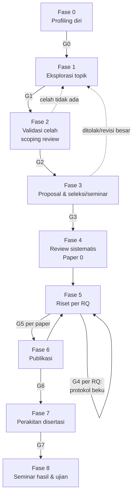
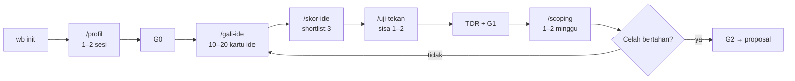

# Spesifikasi PhD-Workbench

> **Status:** draf spesifikasi v0.1, 2026-10-09.
> **Asal:** generalisasi struktur repo disertasi `s3-dissertation` (per 2026-10-09).
> **Sifat dokumen:** rancangan produk untuk repositori baru, bukan bagian disertasi.
> Angka, durasi, dan bobot di dokumen ini adalah **usulan desain**, bukan temuan
> empiris. Semuanya perlu diuji pada pilot dengan pengguna nyata (lihat §13).

---

## 1. Ringkasan

**PhD-Workbench** adalah *template repository* berbasis Markdown dan Git untuk
mahasiswa doktoral, dari sebelum punya topik sampai disertasi selesai. Isinya:

1. **Struktur folder** yang mengikuti siklus hidup studi S3.
2. **Template dokumen** untuk setiap tahap (profil diri, kartu ide, resume paper,
   protokol studi, log riset, catatan bimbingan, dsb.).
3. **Gate keputusan** yang eksplisit — syarat yang harus terpenuhi sebelum masuk
   tahap berikutnya.
4. **Aturan kerja untuk agen AI** (`CLAUDE.md`/`AGENTS.md` ber-placeholder dan
   *skill* percakapan) supaya asisten AI membantu berpikir dan bekerja rapi, tanpa
   mengarang referensi atau menulis disertasi atas nama mahasiswa.
5. **Skrip pemeriksa ringan** (Python stdlib) untuk sitasi, sinkronisasi naskah,
   kebocoran data, dan status proyek.

Pembeda utama terhadap repo asal: repo asal **dimulai setelah topik ada**.
PhD-Workbench menambahkan dua tahap di depan — **profiling diri** dan
**eksplorasi topik** — karena di situlah sebagian besar teman S3 tersendat.

### 1.1 Pengguna sasaran

| Persona | Kondisi | Kebutuhan utama |
|---|---|---|
| **P1 — Belum bertopik** | Baru masuk/akan mendaftar S3, punya minat umum | Profiling diri, eksplorasi & seleksi topik |
| **P2 — Meraba topik** | Punya 2–5 ide, belum yakin mana layak | Uji kelayakan, scoping review, keputusan topik |
| **P3 — Topik ada, kerja berantakan** | Sudah proposal/riset, file tercecer | Struktur, disiplin data & sitasi, rencana publikasi |
| **P4 — Tahap akhir** | Paper sebagian terbit, mulai merakit disertasi | Pemetaan paper→bab, konsistensi, persiapan ujian |

Sasaran awal adalah **P1 dan P2** (sesuai permintaan), tanpa mengorbankan P3–P4.

### 1.2 Non-tujuan

- **Bukan jasa penulisan disertasi.** Agen boleh membuat draf dan mengkritik;
  pemilik naskah tetap mahasiswa (§9.4).
- **Bukan pengganti reference manager.** Zotero/Mendeley tetap dipakai; workbench
  hanya mengonsumsi ekspor `.bib`.
- **Bukan pengganti promotor.** Workbench menyiapkan bahan diskusi dan mencatat
  keputusan bimbingan, bukan mengambil keputusan riset.
- **Bukan aplikasi web.** Versi 1.0 cukup folder + Markdown + skrip. Antarmuka
  web (situs baca) hanya modul opsional.

---

## 2. Analisis Struktur Repo Asal

### 2.1 Peta repo asal

| Folder | Fungsi | Bisa digeneralisasi? |
|---|---|---|
| `00-admin/` | Pendaftaran, promotor, seminar, izin etik | Ya, hampir utuh |
| `01-proposal/` | Draf Markdown + naskah seleksi LaTeX + arsip versi | Ya; naskah seleksi jadi profil kampus |
| `02-literatur/` | PDF per klaster, resume, catatan, SMS, `references.bib` | Ya — **inti nilai repo** |
| `03-riset/` | Satu folder per RQ, subfolder seragam | Ya, sebagai template `rq-*` |
| `04-subjek-sistem/` | Subjek legacy, data sintetis, harness | Sebagian; spesifik riset empiris SE |
| `05-artefak/` | Prototype, prompt library, konfigurasi model LLM | Sebagian; jadi modul "riset komputasi/LLM" |
| `06-publikasi/` | Paper 0–4, respons reviewer, peta venue, strategi | Ya |
| `07-disertasi/` | Kerangka LaTeX disertasi | Ya, dengan profil kampus |
| `08-presentasi/` | Seminar, konferensi, progress report | Ya |
| `09-jurnal-riset/` | Log harian, meeting promotor, retrospeksi, backlog | Ya — **inti nilai repo** |
| `10-reading-site/` | Situs baca MkDocs privat + allowlist/denylist | Modul opsional |
| `10-tugas-kuliah/` | Tugas kuliah yang ditautkan ke disertasi | Ya |
| `99-arsip/` | Materi usang yang masih dirujuk | Ya |
| `CLAUDE.md`, `AGENTS.md` | Aturan mengikat untuk agen AI | Ya, jadi template ber-placeholder |
| `.agents/kanban/` | Board tugas agen (todo→doing→review→done) | Ya, dibuat agen-agnostik |
| `scripts/` | `cek_sinkron_proposal.py`, driver agen | Ya, digeneralisasi (§8) |

### 2.2 Pola yang layak dibawa

1. **Folder bernomor mengikuti siklus hidup.** Orang baru langsung paham urutan
   kerja dari `ls`.
2. **Gate sitasi tiga langkah.** PDF ada → resume dengan kutipan verbatim +
   halaman → entri bib `VERIFIED` dengan bukti. Pelajaran repo asal: metadata
   membuktikan paper itu *ada*, bukan membuktikan *isinya* seperti yang diingat.
   Ini proteksi paling berharga terhadap halusinasi sitasi AI.
3. **Protokol sebelum data**, dengan bagian "penyimpangan dari protokol".
   Membuka opsi *registered report* dan memisahkan eksplorasi dari konfirmasi.
4. **`data/raw/` tidak pernah diedit.** Transformasi hanya lewat skrip.
5. **Batas data eksplisit.** Folder sensitif di-*ignore*, plus aturan tertulis bahwa
   hasil hanya keluar dalam bentuk agregat.
6. **Log keputusan beserta alasannya.** Alasan dibutuhkan untuk bab metodologi
   dan *threats to validity*.
7. **"Asumsi kerja yang mengikat"** di `CLAUDE.md` — premis dari pengguna yang
   harus dipegang agen sampai dicabut (mis. latar belakang penguji, akses data).
8. **Rantai RQ → paper → bab.** Satu tabel pemetaan mencegah disertasi menjadi
   kumpulan paper tanpa cerita.
9. **Checklist "boleh mulai X bila semua YA"** di panduan praktis — gate yang
   konkret, bukan nasihat umum.
10. **Peran agen berlapis.** Agen pekerja (tugas mekanis + bukti mekanis) diaudit
    agen supervisor; keputusan riset tetap di manusia.
11. **Pemeriksa sinkronisasi naskah** — dua dokumen dengan irisan wajib-sama
    dicek otomatis, bukan ditemukan belakangan oleh penguji.
12. **Tugas kuliah ditautkan ke disertasi** — setiap tugas memperkuat rantai RQ.

### 2.3 Masalah yang ditemukan dan harus diperbaiki di versi generik

| Masalah di repo asal | Dampak | Perbaikan di PhD-Workbench |
|---|---|---|
| Tidak ada tahap pra-topik | Tidak berguna bagi P1/P2 | Tambah `01-profil-diri/` dan `02-eksplorasi-topik/` |
| Nomor folder bentrok (`10-reading-site`, `10-tugas-kuliah`) | Urutan ambigu | Penomoran ulang + aturan: satu nomor satu folder |
| README basi (link proposal aktif menunjuk berkas lama; hitungan "21 dari 39" resume; rencana bab masih memuat RQ4 yang sudah dikeluarkan) | Status menipu pembaca dan agen | Status tunggal `STATUS.md` yang **dibangkitkan skrip** dari frontmatter, bukan diketik tangan |
| Aturan tersebar di `CLAUDE.md`, `AGENTS.md`, README tiap folder, panduan praktis | Duplikasi, mudah divergen | Satu sumber aturan (`ATURAN.md`); berkas agen hanya merujuk + menambah aturan khusus agen |
| Path absolut mesin pribadi (`/home/kaqfa/...`) di dokumen dan driver | Tidak portabel | Semua path relatif terhadap akar repo |
| Nama agen spesifik (Prisa/Hermes, Pi) | Terikat alat tertentu | Peran generik: *Supervisor*, *Pekerja*, *Manusia* |
| Folder spesifik disiplin (`subjek-sistem`, `konfigurasi-model`, `prompt-library`) | Tidak cocok untuk riset kualitatif, sosial, kesehatan | Jadikan **modul** yang diaktifkan per jenis riset (§5) |
| Klaster literatur ditulis keras di README | Harus diedit manual per orang | Klaster didefinisikan di `workbench.yaml` |
| Dua template catatan literatur (`catatan/` dan `resume/`) yang tumpang-tindih | Bingung pakai yang mana | Satu template resume dengan dua tingkat: `cepat` dan `penuh` |

---

## 3. Prinsip Desain

1. **Siklus hidup, bukan kategori berkas.** Struktur mengikuti urutan kerja S3.
2. **Gate sebelum kerja mahal.** Tidak ada eksperimen tanpa protokol beku, tidak
   ada sitasi tanpa resume, tidak ada proposal tanpa celah tervalidasi.
3. **Alasan lebih berharga daripada hasil.** Setiap keputusan penting punya
   catatan keputusan (*decision record*).
4. **Status dibangkitkan, bukan diketik.** Ringkasan kemajuan dihitung dari
   frontmatter berkas.
5. **Netral disiplin, modular.** Inti berlaku untuk semua bidang; bagian khusus
   (eksperimen komputasi, kualitatif, survei, *design science*) adalah modul.
6. **Netral agen, tapi siap agen.** Bisa dipakai tanpa AI; dengan AI, aturannya
   sudah tertulis.
7. **Ringan.** Markdown + Git + Python stdlib. Tidak ada server wajib.
8. **Mahasiswa pemilik naskah.** Agen membantu berpikir, mencari, merapikan, dan
   mengkritik — tidak menggantikan penulis.

---

## 4. Siklus Hidup dan Gate

### 4.1 Diagram fase



### 4.2 Definisi gate

Setiap gate adalah berkas checklist di `_gate/`. Gate lolos bila semua butir
bertanda `[x]` **dan** ada catatan keputusan yang ditautkan.

| Gate | Nama | Syarat inti (ringkas) | Bukti |
|---|---|---|---|
| **G0** | Profil cukup | Profil diri terisi; aset & batasan riset terdaftar; target karier dan durasi studi realistis tertulis | `01-profil-diri/profil.md` |
| **G1** | Topik terpilih | ≥10 kartu ide dihasilkan; ≥3 diskor; 1–2 lolos uji tekan; Topic Decision Record (TDR) ditulis | `02-eksplorasi-topik/keputusan/TDR-*.md` |
| **G2** | Celah tervalidasi | Scoping review 1–2 minggu selesai; ≥1 celah bertahan dengan rujukan yang lolos gate sitasi; ada rencana bila celah ternyata sudah diisi | `04-literatur/scoping/hasil.md` |
| **G3** | Proposal siap | Judul, RQ, celah, metode, rencana paper sinkron di semua naskah; semua sitasi `VERIFIED`; dibaca minimal satu pembaca kritis | `cek-sinkron` dan `cek-sitasi` lulus |
| **G4** | Boleh mulai RQ-n | Protokol RQ beku; data/subjek siap; izin etik (bila perlu) ada; rater kedua (bila perlu) tersedia | `05-riset/rq-*/protokol/` + `_gate/G4-rq-*.md` |
| **G5** | Paper siap kirim | Venue diverifikasi (bukan predator); tidak ada pengiriman ganda/salami; replication package dirakit; audit sitasi & angka | `08-publikasi/paper-*/checklist-submit.md` |
| **G6** | Boleh merakit disertasi | Pemetaan RQ→paper→bab final; syarat publikasi kampus terpenuhi atau terjadwal | `09-disertasi/pemetaan.md` |
| **G7** | Naskah siap ujian | Build bersih; konsistensi istilah, angka, dan sitasi; uji tanding pertanyaan penguji | `10-presentasi/ujian/` |

Isi gate di atas adalah **usulan generik**. Syarat formal (jumlah publikasi,
kuartil, format naskah) berbeda per kampus dan **wajib diisi dari pedoman resmi
kampus masing-masing**, bukan dikarang (§7).

---

## 5. Struktur Repository

### 5.1 Pohon folder

```text
phd-workbench/
├── README.md                  # pintu masuk: cara mulai, peta folder
├── ATURAN.md                  # satu sumber aturan kerja (sitasi, data, protokol, gaya)
├── STATUS.md                  # DIBANGKITKAN oleh `wb status` — jangan diedit tangan
├── workbench.yaml             # konfigurasi proyek (§6)
├── CLAUDE.md                  # aturan agen Claude Code — dibangkitkan dari template
├── AGENTS.md                  # aturan agen generik (Codex, Gemini CLI, dll.)
├── _gate/                     # checklist G0–G7
├── _templates/                # semua template dokumen (§7)
├── .claude/skills/            # skill percakapan (§9.3)
├── .agents/kanban/            # board tugas agen: todo/ doing/ review/ done/
├── scripts/                   # CLI `wb` (§8)
│
├── 00-admin/
│   ├── regulasi-kampus/       # pedoman resmi kampus (PDF/ringkasan) — sumber gate formal
│   ├── pendaftaran-beasiswa/
│   ├── promotor/              # profil calon promotor, kecocokan riset
│   ├── izin-etik/
│   └── seminar-ujian/         # berkas administratif, berita acara
├── 01-profil-diri/            # Fase 0
│   ├── profil.md
│   ├── aset-riset.md          # akses data, jaringan, keahlian langka
│   └── refleksi/              # catatan sesi profiling
├── 02-eksplorasi-topik/       # Fase 1
│   ├── kartu-ide/             # satu berkas per ide
│   ├── matriks-skor.md
│   ├── uji-tekan/             # hasil sesi devil's advocate per ide
│   └── keputusan/             # Topic Decision Record (TDR)
├── 03-proposal/
│   ├── draf/                  # naskah kerja (cakupan luas)
│   ├── naskah-resmi/          # naskah sesuai template kampus (LaTeX/Word)
│   ├── versi-arsip/
│   └── seminar-proposal/
├── 04-literatur/
│   ├── pdf/<klaster>/
│   ├── resume/                # satu berkas per paper, frontmatter wajib
│   ├── bibliografi/references.bib
│   ├── scoping/               # Fase 2
│   └── review-sistematis/     # protokol SLR/SMS, query log, screening, PRISMA
├── 05-riset/
│   ├── _rq-template/
│   └── rq1-<slug>/
│       ├── protokol/          # ditulis & dibekukan sebelum data
│       ├── eksperimen/        # atau: instrumen/ untuk riset kualitatif/survei
│       ├── data/raw/          # tidak pernah diedit
│       ├── data/processed/
│       ├── analisis/          # skrip/notebook
│       └── hasil/
├── 06-subjek-data/            # MODUL: data sensitif, data sintetis, subjek publik
├── 07-artefak/                # MODUL: prototype, kode, prompt, konfigurasi model
├── 08-publikasi/
│   ├── peta-venue.md
│   ├── strategi-publikasi.md
│   ├── paper-0-<slug>/        # naskah/ gambar/ submission/ review-ronde-N/
│   └── respons-reviewer/
├── 09-disertasi/
│   ├── pemetaan.md            # RQ → paper → bab
│   └── naskah/                # kerangka LaTeX/Word sesuai profil kampus
├── 10-presentasi/
├── 11-jurnal-riset/
│   ├── log/                   # YYYY-MM-DD.md
│   ├── bimbingan/             # catatan pertemuan promotor
│   ├── keputusan/             # decision record lintas fase
│   ├── retrospeksi/           # per kuartal
│   └── backlog-ide/
├── 12-kuliah/                 # tugas kuliah ditautkan ke disertasi
└── 99-arsip/                  # prefiks tanggal: YYYY-MM-DD-nama/
```

Folder yang belum relevan tetap ada tetapi hanya berisi `README.md` satu paragraf:
**apa isinya** dan **kapan mulai dipakai**. Ini mempertahankan peta lengkap tanpa
membebani pengguna baru.

### 5.2 Modul per jenis riset

`wb init` menanyakan jenis riset, lalu mengaktifkan modul yang sesuai.

| Modul | Untuk | Menambah |
|---|---|---|
| `eksperimen-komputasi` | SE, ML, sistem, HPC | `07-artefak/`, `konfigurasi-lingkungan/`, log versi pustaka & seed |
| `riset-llm` | Riset yang memakai LLM sebagai alat/objek | `prompt-library/` berversi, `konfigurasi-model/` (provider, versi, *temperature*, seed, tanggal akses) |
| `data-sensitif` | Data institusi, pasien, siswa | `06-subjek-data/{sensitif,teranonimisasi,sintetis}`, aturan `.gitignore`, `cek-data` sebagai *pre-commit hook* |
| `kualitatif` | Wawancara, studi kasus, *grounded theory* | `instrumen/`, `transkrip/` (sensitif), *codebook*, catatan *inter-rater agreement* |
| `survei` | Kuesioner | `instrumen/`, validasi instrumen, rencana sampling |
| `design-science` | Riset rancang-bangun artefak | Siklus rancang–evaluasi, kriteria evaluasi artefak |
| `situs-baca` | Membaca naskah dari HP, berbagi ke promotor | Ekspor *allowlist* → MkDocs, pemeriksa keamanan publikasi |

Modul boleh lebih dari satu. Daftar ini adalah titik awal; penambahan modul
dilakukan lewat `_templates/modul/<nama>/`.

---

## 6. Konfigurasi `workbench.yaml`

Satu berkas yang menjadi sumber parameter untuk skrip dan template agen.

```yaml
proyek:
  pemilik: "Nama Mahasiswa"
  bahasa_naskah: id            # id | en
  fase_aktif: 1                # 0–8
kampus:
  nama: "Universitas X"
  prodi: "Program Doktor Y"
  gaya_sitasi: apa             # apa | ieee | harvard | ...
  format_naskah: latex         # latex | docx | markdown
  pedoman_resmi: 00-admin/regulasi-kampus/pedoman-disertasi.pdf   # kosong = belum dicek
riset:
  disiplin: "software engineering"
  jenis: [eksperimen-komputasi, riset-llm, data-sensitif]
  rq: []                       # diisi setelah G2
  klaster_literatur: [oracle-testing, code-translation]
pembaca:
  # generalisasi "asumsi kerja" repo asal: siapa yang akan membaca/menguji naskah
  latar_penguji: "mayoritas machine learning & computer vision"
  catatan: "konsep inti diberi padanan istilah bidang penguji, disisipkan, bukan didaftar"
data:
  folder_sensitif: [06-subjek-data/sensitif, 06-subjek-data/teranonimisasi]
  boleh_ke_model_tertutup: false
agen:
  dipakai: [claude-code]       # claude-code | codex | gemini | none
  peran: [supervisor, pekerja]
naskah_sinkron:                # pasangan naskah yang irisannya wajib sama
  - a: 03-proposal/naskah-resmi/main.tex
    b: 03-proposal/draf/proposal.md
    irisan: [judul, rq, celah]
```

Bagian `pembaca` adalah generalisasi pola terbaik repo asal: penulis SE dengan
penguji berlatar ML. Banyak mahasiswa S3 di Indonesia menghadapi situasi serupa
(prodi doktor ilmu komputer generik dengan penguji lintas bidang). Agen memakai
field ini untuk menyesuaikan penjelasan tanpa mengubah disiplin riset.

---

## 7. Katalog Template

Semua template di `_templates/`. Kolom "Wajib frontmatter" menandai template yang
dibaca oleh `wb status`.

| Template | Fase | Isi pokok | Wajib frontmatter |
|---|---|---|---|
| `profil-diri.md` | 0 | Latar pendidikan & kerja, keahlian (teknis, metodologis, menulis), minat, motivasi S3, target karier, batasan (waktu, dana, durasi beasiswa, keluarga), gaya kerja | Ya |
| `aset-riset.md` | 0 | Akses data/sistem/populasi, jaringan kolaborator, posisi institusional, alat & dana; tiap aset diberi status: pasti / perlu izin / spekulatif | Ya |
| `kartu-ide.md` | 1 | Masalah satu kalimat; siapa yang peduli; 3–5 paper pemicu (status verifikasi); aset yang dipakai; gambaran metode; potensi 3 paper; risiko terbesar | Ya |
| `matriks-skor.md` | 1 | Kriteria berbobot (§7.1) | Tidak |
| `uji-tekan.md` | 1 | Pertanyaan devil's advocate + jawaban + verdict | Ya |
| `TDR.md` (*Topic Decision Record*) | 1 | Konteks, opsi yang dipertimbangkan, keputusan, alasan, **kriteria pembatalan**, tanggal tinjau ulang | Ya |
| `scoping-review.md` | 2 | Pertanyaan, string pencarian, sumber, hasil per celah, verdict celah | Ya |
| `rantai-kontribusi.md` | 2–3 | Thesis statement → celah → RQ → metode → paper → bab | Tidak |
| `resume-paper.md` | semua | Dua tingkat: `cepat` (posisi/eksistensi) dan `penuh` (klaim angka + kutipan verbatim + halaman) | Ya |
| `protokol-studi.md` | 5 | Diambil dari repo asal: desain, subjek, konfigurasi, prosedur, metrik, *threats to validity*, penyimpangan | Ya |
| `log-harian.md` | semua | Fokus, dikerjakan, keputusan & alasan, buntu, berikutnya | Tidak |
| `bimbingan.md` | semua | Agenda, dilaporkan, masukan, keputusan, action item bertanggal | Ya |
| `keputusan.md` (ADR riset) | semua | Konteks, opsi, keputusan, alasan, konsekuensi | Ya |
| `checklist-submit.md` | 6 | Venue terverifikasi, cek predator, kebijakan AI venue, salami/ganda, replication package | Ya |
| `respons-reviewer.md` | 6 | Tabel komentar → tanggapan → perubahan (halaman/baris) | Tidak |
| `retrospeksi.md` | semua | Per kuartal: rencana vs realisasi, apa yang berubah, RQ masih relevan? | Tidak |
| `profil-kampus/<kampus>/` | 3, 7 | Template naskah seleksi & disertasi kampus tertentu | — |

### 7.1 Kriteria skor topik (usulan)

Skor 1–5 per kriteria. **Skor adalah alat diskusi, bukan keputusan.** Ide dengan
skor tertinggi tetap harus lolos uji tekan dan scoping review.

| Kriteria | Pertanyaan pemandu | Bobot usulan |
|---|---|---|
| Kecocokan profil | Apakah memakai keahlian dan aset yang benar-benar saya punya? | 20% |
| Kelayakan data/akses | Data, subjek, atau sistem tersedia dalam 6 bulan pertama? | 20% |
| Indikasi kebaruan | Scan cepat menunjukkan celah? (masih hipotesis sampai G2) | 15% |
| Dapat dipecah jadi 3–4 studi | Ada rantai RQ yang saling bergantung secara alami? | 15% |
| Kecocokan promotor & prodi | Ada calon promotor dengan keahlian dekat? Sesuai bidang prodi? | 10% |
| Jalur publikasi | Ada venue dan komunitas jelas? | 10% |
| Motivasi bertahan 3–4 tahun | Masih mau mengerjakan ini di tahun ketiga? | 10% |

Kriteria **gugur langsung** (tidak dihitung bobot): butuh data yang mustahil
diakses, butuh dana di luar jangkauan, atau melanggar etika.

### 7.2 Daftar pertanyaan uji tekan (usulan)

1. Siapa yang rugi bila masalah ini tidak pernah diselesaikan?
2. Mengapa belum ada yang mengerjakannya — sulit, tidak penting, atau sudah ada
   tapi tidak saya temukan?
3. Apa yang terjadi pada disertasi bila celah ternyata sudah diisi paper yang
   terbit bulan depan?
4. Apa satu eksperimen/studi terkecil yang bisa membuktikan ide ini layak dalam
   4–6 minggu?
5. Apa yang akan dikatakan penguji dengan latar `pembaca.latar_penguji`?
6. Kontribusinya metode, artefak, bukti empiris, atau teori? Bisa dievaluasi
   bagaimana?
7. Bila hasilnya negatif, apakah masih bisa dipublikasikan?

---

## 8. Skrip `wb` (CLI)

Python 3.10+, stdlib saja, satu paket di `scripts/wb/`. Setiap perintah idempoten
dan hanya menulis di lokasi yang jelas.

| Perintah | Fungsi | Asal |
|---|---|---|
| `wb init` | Wawancara singkat → isi `workbench.yaml`, aktifkan modul, bangkitkan `CLAUDE.md`/`AGENTS.md` dari template | Baru |
| `wb new ide <slug>` | Buat kartu ide dari template | Baru |
| `wb new rq <slug>` | Salin `_rq-template/` → `05-riset/rqN-<slug>/` | Generalisasi `03-riset/` |
| `wb new paper <slug>` | Buat folder paper standar | Generalisasi `06-publikasi/` |
| `wb new resume <bibkey>` | Buat resume dari template, isi frontmatter dari `.bib` | Generalisasi template resume |
| `wb log` | Buat/buka `11-jurnal-riset/log/<hari-ini>.md` | Baru |
| `wb cek sitasi` | Setiap kunci sitasi di naskah: ada di `.bib`, `note` VERIFIED, ada resume; tandai bila resume `cepat` dipakai di naskah | Generalisasi gate sitasi |
| `wb cek sinkron` | Bandingkan irisan wajib-sama antar pasangan naskah di `workbench.yaml` (Jaccard + frasa penanda) | Generalisasi `cek_sinkron_proposal.py` |
| `wb cek data` | Tolak commit bila berkas dari `folder_sensitif` atau pola sensitif (NIK, email massal, `.sql` dump) ikut *staged*; dipasang sebagai *pre-commit hook* | Baru, dari aturan batas data |
| `wb cek gate <G>` | Laporkan butir gate yang belum terpenuhi | Baru |
| `wb status` | Bangkitkan `STATUS.md`: fase aktif, gate, jumlah ide/resume/RQ/paper per status, utang sitasi, log terakhir | Baru, mengatasi README basi |

Batas yang disengaja: `wb cek sitasi` hanya memeriksa **keberadaan dan status**,
bukan kebenaran isi klaim. Kebenaran isi tetap diperiksa manusia atau agen
supervisor dengan membaca kutipan verbatim di resume.

---

## 9. Integrasi Agen AI

### 9.1 Berkas aturan

- `ATURAN.md` — aturan manusia dan agen (sitasi, data, protokol, gaya bahasa).
- `CLAUDE.md` / `AGENTS.md` — dibangkitkan dari template + `workbench.yaml`. Isi:
  konteks proyek, **asumsi kerja yang mengikat** (dari `pembaca`, `data`),
  peran agen, dan rujukan ke `ATURAN.md`. Tidak menduplikasi aturan.

### 9.2 Peran

| Peran | Tugas | Batas |
|---|---|---|
| **Manusia (mahasiswa)** | Keputusan riset, lolos/gagal gate, isi final naskah | — |
| **Supervisor** | Kritik argumen, audit kerja pekerja, cek kutipan verbatim, menyusun draf yang ditandai | Tidak meloloskan gate |
| **Pekerja** | Tugas mekanis: pencarian API (Crossref, OpenAlex, arXiv, Semantic Scholar), unduh PDF terbuka, draf resume, skrip analisis, dedup | Wajib menyertakan bukti mekanis yang bisa dicek ulang |

Board `.agents/kanban/` dipertahankan dari repo asal. Setiap tugas memuat *Goal,
Scope, Acceptance Criteria, Verification Commands*.

### 9.3 Skill percakapan (Claude Code)

Skill adalah prosedur percakapan terpandu di `.claude/skills/`. Agen lain dapat
memakai isi yang sama sebagai prompt.

| Skill | Fase | Perilaku |
|---|---|---|
| `/profil` | 0 | Wawancara bertahap (satu tema per giliran) → mengisi `profil.md` dan `aset-riset.md`. Menandai aset yang masih spekulatif. |
| `/gali-ide` | 1 | Membangkitkan ide dari empat sumber: masalah di pekerjaan, aset unik × tren bidang, bagian *future work* paper yang sudah dibaca, kebutuhan institusi. Hasil berupa kartu ide; setiap paper yang disebut bertanda `[CARI: ...]` sampai diverifikasi. |
| `/skor-ide` | 1 | Mengisi matriks bersama pengguna. Agen mengajukan skor beserta alasan; pengguna yang menetapkan. |
| `/uji-tekan` | 1–3 | Agen berperan sebagai penguji skeptis memakai daftar §7.2 dan `pembaca.latar_penguji`. Tidak boleh setuju hanya untuk menyenangkan. |
| `/scoping` | 2 | Menyusun string pencarian, menjalankan pencarian API, mengisi tabel celah. Verdict celah diputuskan pengguna. |
| `/resume` | semua | Membaca PDF, membuat resume dengan kutipan verbatim + halaman. Klaim yang tidak ditemukan ditulis "tidak ditemukan di naskah". |
| `/rantai` | 2–3 | Memeriksa apakah setiap RQ terjawab metode, setiap celah punya RQ, setiap RQ punya paper. |
| `/kritik-naskah` | 3, 6, 7 | Kritik struktur & argumen; menandai klaim tanpa data, sitasi tanpa resume, kalimat terlalu panjang. |
| `/bimbingan` | semua | Menyiapkan agenda dari log sejak pertemuan terakhir; sesudahnya merapikan catatan menjadi action item bertanggal. |
| `/retro` | per kuartal | Membandingkan rencana dan realisasi dari log; mengusulkan penyesuaian. |

### 9.4 Etika dan integritas akademik

Ini bagian yang paling mudah disalahgunakan, sehingga ditulis tegas di
`ATURAN.md`:

1. **Agen tidak menulis disertasi atas nama mahasiswa.** Draf agen selalu ditandai
   dan disunting penuh oleh pemilik. Workbench tidak boleh menjadi alat "joki".
2. **Tidak mengarang referensi.** Hanya entri yang lolos gate sitasi yang boleh
   masuk naskah submit.
3. **Tidak mengarang data atau hasil.** Placeholder eksplisit:
   `[TODO: butuh data dari RQ-n]`.
4. **Ikuti kebijakan penggunaan AI** dari kampus dan venue. Template
   `checklist-submit.md` memuat butir pernyataan penggunaan AI.
5. **Data sensitif tidak dikirim ke model tertutup** kecuali
   `data.boleh_ke_model_tertutup: true` dan diizinkan pemilik data.
6. **Bedakan temuan, rencana, dan spekulasi** dalam setiap draf.

---

## 10. Alur Penggunaan per Persona

### 10.1 P1 — Belum bertopik (estimasi 6–10 minggu sampai G2)



Estimasi durasi di atas adalah **asumsi desain** yang perlu diuji pada pilot.

### 10.2 P2 — Meraba topik

Mulai dari `/profil` versi singkat (aset dan batasan saja), lalu langsung memasukkan
ide yang sudah ada sebagai kartu ide. Fokus pada uji tekan dan scoping review.

### 10.3 P3 — Topik ada, kerja berantakan

`wb init` dengan `fase_aktif` 3–5. Pindahkan berkas lama ke folder yang sesuai
(panduan migrasi di `README.md`). Prioritas: `references.bib` + status `note`,
protokol RQ aktif, log keputusan yang direkonstruksi.

### 10.4 P4 — Tahap akhir

Fokus pada `09-disertasi/pemetaan.md`, `wb cek sitasi` di naskah disertasi,
dan `/uji-tekan` dengan persona penguji ujian tertutup.

---

## 11. Ritme Kerja Bawaan

Diambil dari panduan praktis repo asal, dibuat generik.

| Irama | Aktivitas |
|---|---|
| Setiap sesi | `wb log`; catat keputusan + alasan, bukan sekadar aktivitas |
| Mingguan | Satu sesi resume literatur fase aktif; perbarui board agen |
| Sebelum bimbingan | `/bimbingan` untuk agenda; sesudahnya action item bertanggal |
| Bulanan | `wb status`; audit `git status` & data sensitif; rebuild hasil dari `data/raw/` |
| Per kuartal | `/retro`; tinjau ulang TDR (masih valid? kriteria pembatalan terpicu?) |
| Sebelum submit/seminar | `wb cek sitasi`, `wb cek sinkron`, build bersih, `/uji-tekan` |

---

## 12. Peta Migrasi dari Repo Asal

| Repo asal | PhD-Workbench | Perlakuan |
|---|---|---|
| `00-admin/` | `00-admin/` | Tambah `regulasi-kampus/` |
| — | `01-profil-diri/`, `02-eksplorasi-topik/` | Baru |
| `01-proposal/` | `03-proposal/` | `seleksi-udinus/` → `naskah-resmi/` + profil kampus |
| `02-literatur/catatan/` + `resume/` | `04-literatur/resume/` | Digabung, dua tingkat |
| `02-literatur/systematic-mapping/` | `04-literatur/scoping/` + `review-sistematis/` | Scoping dipisah karena masuk gate G2 |
| `03-riset/` | `05-riset/` | Tetap; `_TEMPLATE-protokol-studi.md` → `_templates/` |
| `04-subjek-sistem/` | `06-subjek-data/` (modul) | Dinetralkan dari SE |
| `05-artefak/` | `07-artefak/` (modul) | `prompt-library`, `konfigurasi-model` → modul `riset-llm` |
| `06-publikasi/` | `08-publikasi/` | Peta venue & strategi jadi template |
| `07-disertasi/` | `09-disertasi/` | Kerangka LaTeX → profil kampus |
| `08-presentasi/` | `10-presentasi/` | Tetap |
| `09-jurnal-riset/` | `11-jurnal-riset/` | Tambah `keputusan/` |
| `10-tugas-kuliah/` | `12-kuliah/` | Tetap |
| `10-reading-site/` | Modul `situs-baca` | Opsional; path absolut & host pribadi dihapus |
| `CLAUDE.md`, `AGENTS.md` | `ATURAN.md` + template agen | Dipisah: aturan vs konteks |
| `scripts/cek_sinkron_proposal.py` | `wb cek sinkron` | Dibuat terkonfigurasi |
| `scripts/pi_sms_driver.py` | — | Tidak dibawa; terlalu spesifik |

**Tidak boleh ikut tersalin:** isi `references.bib`, resume, PDF, data, naskah,
dan semua nama institusi/sistem dari repo asal. Yang dibawa hanya struktur,
template kosong, dan contoh fiktif.

---

## 13. Rencana Pengembangan

| Versi | Isi | Kriteria selesai |
|---|---|---|
| **v0.1** | Pohon folder, `README.md`, `ATURAN.md`, semua template §7, gate G0–G7 sebagai checklist | Satu orang bisa memulai Fase 0–1 hanya dengan membaca README |
| **v0.2** | Skill `/profil`, `/gali-ide`, `/skor-ide`, `/uji-tekan`, template `CLAUDE.md` | Satu sesi profiling + eksplorasi menghasilkan ≥10 kartu ide |
| **v0.3** | `wb init`, `wb new *`, `wb log`, `wb status` | `STATUS.md` akurat tanpa edit tangan |
| **v0.4** | `wb cek sitasi`, `wb cek sinkron`, `wb cek data` + *pre-commit hook*; skill `/resume`, `/scoping` | Sitasi tak terverifikasi gagal dicek otomatis |
| **v0.5** | Modul per jenis riset, profil kampus pertama (Udinus), skill `/bimbingan`, `/retro`, `/kritik-naskah` | Bisa dipakai riset non-SE |
| **v1.0** | Pilot dengan 3–5 teman S3 dari ≥2 disiplin; revisi berdasar umpan balik | Lihat metrik pilot di bawah |

### 13.1 Metrik pilot (usulan, belum diuji)

- Berapa pengguna P1/P2 yang mencapai TDR (G1) dalam 8 minggu.
- Berapa kartu ide yang gugur di uji tekan atau scoping review (gugur cepat
  adalah tanda sistem bekerja, bukan gagal).
- Jumlah sitasi yang tertangkap `wb cek sitasi` sebelum sampai ke promotor.
- Bagian struktur yang tidak pernah disentuh pengguna (kandidat dihapus).
- Wawancara singkat: bagian mana yang terasa birokratis.

---

## 14. Risiko Desain

| Risiko | Mengapa nyata | Mitigasi |
|---|---|---|
| **Terlalu berat untuk pengguna non-teknis** | Git, YAML, CLI asing bagi banyak mahasiswa di luar ilmu komputer | Jalur tanpa Git: unduh ZIP + Obsidian/VS Code; skrip opsional; README "mulai dalam 15 menit" |
| **Birokrasi mengalahkan riset** | 17 template dan 8 gate bisa terasa seperti formulir | Folder fase belum aktif hanya berisi README; gate bisa dilewati dengan catatan alasan |
| **Disalahgunakan sebagai alat joki** | Skill agen cukup kuat untuk menghasilkan draf panjang | §9.4 di `ATURAN.md`; draf agen bertanda; skill menulis selalu berakhir dengan daftar bagian terlemah |
| **Bias disiplin SE** | Diturunkan dari satu repo SE | Pilot lintas disiplin di v1.0; modul kualitatif & survei sejak v0.5 |
| **Halusinasi sitasi tetap lolos** | Agen bisa menulis resume dengan kutipan karangan | Kutipan verbatim harus grep-able ke teks PDF; audit acak oleh supervisor/manusia |
| **Kebocoran data sensitif** | Pengguna mengirim data ke model tertutup atau ter-commit | `.gitignore` bawaan, `wb cek data` sebagai hook, field `boleh_ke_model_tertutup` |
| **Aturan kampus dikarang** | Agen mengisi syarat publikasi/format dari ingatan | Gate formal hanya dari `00-admin/regulasi-kampus/`; bila kosong, gate menulis "belum dicek" |
| **Template basi** | Seperti README repo asal | Status dibangkitkan skrip; template diberi versi |

---

## 15. Keputusan Terbuka

Hal-hal yang perlu diputuskan pemilik proyek sebelum membuat repository:

1. **Bahasa template.** Indonesia saja, atau dwibahasa sejak awal?
2. **Lisensi.** Usulan: MIT untuk skrip, CC BY 4.0 untuk template dan panduan.
3. **Agen utama.** Skill ditulis untuk Claude Code lebih dulu, atau langsung
   format netral yang bisa dibaca beberapa agen?
4. **Format naskah default.** LaTeX (repo asal) atau Word/Markdown (lebih
   familiar bagi banyak prodi)?
5. **Distribusi.** *GitHub template repository*, atau `wb init` yang menyalin
   kerangka ke folder kosong?
6. **Profil kampus pertama.** Udinus saja, atau dibiarkan kosong dengan panduan
   mengisi?

---

## Lampiran A — Contoh Isi `profil-diri.md`

```markdown
---
jenis: profil-diri
tanggal: YYYY-MM-DD
status: draf            # draf | cukup (G0)
---

# Profil Diri

## Latar
- Pendidikan S1/S2 & topik tesis:
- Pekerjaan saat ini & lama:
- Publikasi sebelumnya (bila ada):

## Keahlian
| Area | Tingkat (1–5) | Bukti |
|---|---|---|

## Minat
- Topik yang saya baca tanpa disuruh:
- Masalah di pekerjaan yang membuat saya penasaran:

## Aset riset (rinci di aset-riset.md)
- Akses data/sistem/populasi:
- Jaringan/kolaborator:

## Batasan
- Durasi studi target & batas beasiswa:
- Waktu per minggu yang realistis:
- Dana riset:

## Tujuan setelah S3
- 

## Catatan agen
> Bagian yang masih spekulatif atau perlu dikonfirmasi.
```

## Lampiran B — Contoh Isi `TDR.md`

```markdown
---
jenis: tdr
id: TDR-001
tanggal: YYYY-MM-DD
status: berlaku         # berlaku | ditinjau | dibatalkan
tinjau_ulang: YYYY-MM-DD
---

# TDR-001: <judul topik>

## Konteks
Mengapa keputusan ini perlu diambil sekarang.

## Opsi yang dipertimbangkan
| Ide | Skor | Hasil uji tekan | Alasan tidak dipilih |
|---|---|---|---|

## Keputusan
Topik yang dipilih, satu paragraf.

## Alasan
Merujuk profil, aset, dan hasil scan literatur.

## Kriteria pembatalan
Kondisi konkret yang membuat topik ini dibuka ulang
(mis. scoping review menemukan celah sudah diisi; akses data ditolak).

## Langkah berikutnya
- [ ] Scoping review (target: YYYY-MM-DD)
```
